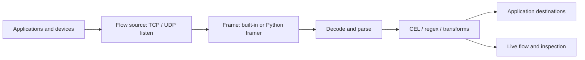

<p align="center">
  
</p>

<h1 align="center">GoFi</h1>

GoFi connects abnormal or unknown data to the applications that need it. Each
**flow** takes data from a source, frames and decodes it, evaluates processing
stages, and routes selected messages to destinations. Today a flow's source is a
TCP or UDP **listen** source; pulled sources (HTTP fetch, NATS/MQTT/WebSocket/SSE
subscriptions, and Python fetchers/streamers) are planned in
[flows and sources](docs/flows.md). The portal follows Grafana's structure and
dark theme, built with `@grafana/ui`.



## Run the binary

Use the Go version in `go.mod` and Node.js 22.12 or newer:

```sh
npm --prefix ui ci
npm --prefix ui run build
GOWORK=off go build -o bin/gofi .
GOFI_DRIVER=inprocess ./bin/gofi
```

Open <http://localhost:9090>. Flow configuration persists by default in
`gofi/listeners.yaml` under the operating system's user configuration directory.
Set `GOFI_CONFIG_FILE=./listeners.yaml` to choose a file. Python libraries use a
separate `sandboxes.yaml` file alongside it and run in isolated workers, requiring
Docker for binary and Docker deployments.

To run the live sample against a running local portal:

```sh
python3 scripts/demo.py --api http://127.0.0.1:9090 --port 10001
```

This creates a saved example flow and continuously sends sample traffic to TCP
10001. The [application walkthrough](docs/application.md) covers decoders,
filters, destinations, mock mode, and real replay.

## Deploy

| Method | Portal | Durable configuration | Flow runtime |
| --- | --- | --- | --- |
| Binary | `http://localhost:9090` by default | Local YAML files | In-process sockets |
| Docker Compose | `http://localhost:9091` by default | Mounted data volume | Sibling containers using the Docker socket |
| Kubernetes / UDS | `https://gofi.admin.uds.dev` by default | Namespaced Flow and Sandbox CRDs | Managed Pods and Services |

The UDS package configures the admin tenant gateway and Authservice SSO. Binary
and Compose deployments expose no built-in identity provider. See
[deployment](docs/deployment.md) and [UDS configuration](docs/configuration.md)
for environment settings and package boundaries.

## Configure traffic

Kubernetes resources use `gofi.wcrum.dev/v1alpha1`. Portal edits and declarative
file or CRD edits share the same desired-state contract. The controller reloads
external changes and repairs missing or drifted runtimes. Invalid snapshots
retain the last good configuration.

| Capability | Options |
| --- | --- |
| Frame bytes | Raw, newline, delimiter, or length prefix; per TCP connection, UDP datagram, or [QUIC stream](docs/quic.md) |
| Decode | Base64, base64url, base32, hex, URL query decoding; gzip, zlib, deflate, zstd, snappy, LZ4, Brotli, bzip2 |
| Parse and extend | JSON, XML, text, isolated [Python function libraries](docs/python.md) (with a flow-wide default library) |
| Parse layered data | Any number of [parse stages](docs/flows.md#parse-stages): parse a field (or the frame) again, with its own decoders, into a nested field |
| Process | CEL, RE2 regex, transforms, schema checks, deduplication, rate limits |
| Deliver | HTTP, TCP, UDP, [QUIC](docs/quic.md) (TLS 1.3, multiplexed), NATS, stdout, Loki, [Zenoh](docs/zenoh.md) (REST router; also a subscribe source), local [Aster agent](docs/aster.md) |
| Select Kubernetes destinations | Service URLs or ready Pods matching label selectors |
| Inspect and replay | One ConnectRPC live stream for all flows; explicit TCP/UDP replay |
| Ask [GoFiBot](docs/assistant.md) | Built-in chat over the Anthropic Messages API: reads flows, CEL, Python libraries, and docs; validates drafts; applies changes only when an administrator allows it |

The protobuf contracts in [`proto/gofi/v1`](proto/gofi/v1) define all application
management and streaming operations. Browser, Go, and Python worker clients use
ConnectRPC; the former application REST and SSE routes are retired. Health
probes, static files, and Prometheus metrics remain HTTP endpoints.

## Verify changes

```sh
GOWORK=off go test -race ./...
GOWORK=off go vet ./...
npm --prefix ui test
npm --prefix ui run build
scripts/chart-test.sh      # helm lint, every values overlay, helm-unittest suites
```

The `Taskfile.yml` test pyramid wraps the longer suites: `task test:unit`,
`task test:race`, `task test:integration` (controller convergence against an
envtest kube-apiserver), `task test:e2e` / `task test:e2e:k3d` (chaos
scenarios against the binary, Compose, or a throwaway k3d cluster),
`task test:chaos`, `task test:scale` (10→100→500 flows), `task test:ui:e2e`
(Playwright portal smoke), and `task test:bench` (data-plane benchmarks).
`go test ./config/` also fails when `docs/configuration.md` drifts from the
`config` package's variable table.

CI also checks generated bindings, Python worker tests, image builds, and the
isolated Docker worker integration. See [verification evidence](docs/verification.md)
for the checks actually completed in the current environment, and
[design justifications](docs/justifications.md) for implementation choices.

Live inspection is a bounded, best-effort view. A successful network write or
sink call does not establish downstream application processing. GoFi currently
has one active controller and no durable message history or outbox.
