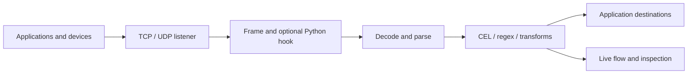

# GoFi

GoFi receives TCP and UDP traffic, decodes application frames, evaluates
processing stages, and routes selected messages to other applications. The
portal keeps the flow in the main workspace, with tools on the left and an
all-listeners view. Its dark theme combines Grafana-inspired navigation with
the existing GoFi flow colors and visual language.



## Run the binary

Use the Go version in `go.mod` and Node.js 22.12 or newer:

```sh
npm --prefix ui ci
npm --prefix ui run build
GOWORK=off go build -o bin/gofi .
GOFI_DRIVER=inprocess ./bin/gofi
```

Open <http://localhost:9090>. Listener configuration persists by default in
`gofi/listeners.yaml` under the operating system's user configuration directory.
Set `GOFI_CONFIG_FILE=./listeners.yaml` to choose a file. Python libraries use a
separate `sandboxes.yaml` file alongside it and run in isolated workers, requiring
Docker for binary and Docker deployments.

To run the live sample against a running local portal:

```sh
python3 scripts/demo.py --api http://127.0.0.1:9090 --port 10001
```

This creates a saved example flow and continuously sends sample traffic to TCP
10001. The [application walkthrough](docs/application.md) covers decoders,
filters, destinations, mock mode, and real replay.

## Deploy

| Method | Portal | Durable configuration | Listener runtime |
| --- | --- | --- | --- |
| Binary | `http://localhost:9090` by default | Local YAML files | In-process sockets |
| Docker Compose | `http://localhost:9091` by default | Mounted data volume | Sibling containers using the Docker socket |
| Kubernetes / UDS | `https://gofi.admin.uds.dev` by default | Namespaced Listener and Sandbox CRDs | Managed Pods and Services |

The UDS package configures the admin tenant gateway and Authservice SSO. Binary
and Compose deployments expose no built-in identity provider. See
[deployment](docs/deployment.md) and [UDS configuration](docs/configuration.md)
for environment settings and package boundaries.

## Configure traffic

Kubernetes resources use `gofi.wcrum.dev/v1alpha1`. Portal edits and declarative
file or CRD edits share the same desired-state contract. The controller reloads
external changes and repairs missing or drifted runtimes. Invalid snapshots
retain the last good configuration.

| Capability | Options |
| --- | --- |
| Frame bytes | Raw, newline, delimiter, or length prefix |
| Decode | Base64, base64url, hex, gzip, zlib, URL query decoding |
| Parse and extend | JSON, XML, text, isolated [Python function libraries](docs/python.md) |
| Process | CEL, RE2 regex, transforms, schema checks, deduplication, rate limits |
| Deliver | HTTP, TCP, UDP, NATS, stdout, Loki, [Zenoh REST router](docs/zenoh.md), local [Aster agent](docs/aster.md) |
| Select Kubernetes destinations | Service URLs or ready Pods matching label selectors |
| Inspect and replay | One ConnectRPC live stream for all listeners; explicit TCP/UDP replay |

The protobuf contracts in [`proto/gofi/v1`](proto/gofi/v1) define all application
management and streaming operations. Browser, Go, and Python worker clients use
ConnectRPC; the former application REST and SSE routes are retired. Health
probes, static files, and Prometheus metrics remain HTTP endpoints.

## Verify changes

```sh
GOWORK=off go test -race ./...
GOWORK=off go vet ./...
npm --prefix ui test
npm --prefix ui run build
helm lint charts/gofi chart
```

CI also checks generated bindings, Python worker tests, image builds, and the
isolated Docker worker integration. See [verification evidence](docs/verification.md)
for the checks actually completed in the current environment, and
[design justifications](docs/justifications.md) for implementation choices.

Live inspection is a bounded, best-effort view. A successful network write or
sink call does not establish downstream application processing. GoFi currently
has one active controller and no durable message history or outbox.
