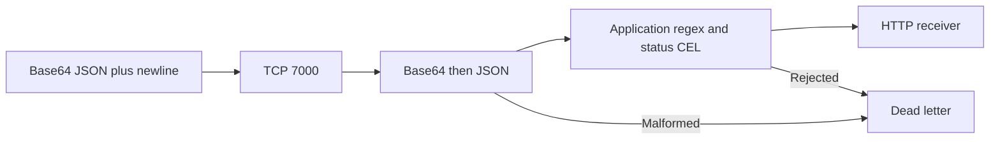

# Work with live traffic

## Sign in and see every listener

For UDS, open `https://gofi.admin.uds.dev` and complete the identity-provider
login. The portal, management RPCs, and live traffic stream share this protected
origin. Standalone binary runs default to `http://localhost:9090`; Compose
publishes `http://localhost:9091`.

The left sidebar contains the primary tools. The all-listeners flow is the main
perspective: inspect sources, processing stages, and destinations, then select a
listener to edit its individual pipeline. Live inspection shows parsed fields,
source metadata, and rejection attribution. The portal uses one ConnectRPC
`WatchTraffic` stream for the overview, including listeners added after it opens.
Slow viewers can miss events; the stream is a live view, not a durable audit log.

## Receive → decode → filter → deliver

For a local walkthrough, start the receiver in another terminal:

```sh
python3 examples/receiver.py
```

Save this as `listeners.yaml` and start GoFi with
`GOFI_CONFIG_FILE=./listeners.yaml GOFI_DRIVER=inprocess ./bin/gofi`:

```yaml
apiVersion: gofi.wcrum.dev/v1alpha1
kind: Listener
metadata:
  name: telemetry
spec:
  source: {port: 7000, network: tcp}
  framing: {mode: line}
  parser:
    format: json
    decoders: [base64]
    errorPolicy: drop
  stages:
    - id: application
      kind: filter
      type: regex
      field: app
      expression: '^payments$'
    - id: successful
      kind: filter
      type: cel
      expression: '"status" in fields && fields["status"] >= 200 && fields["status"] < 300'
  sinks:
    - type: http
      url: http://127.0.0.1:8080/events
      bodyMode: wrapped
  deadLetterSink: {type: stdout}
```



Open the telemetry flow and inspect traffic, then send an accepted sample:

```sh
printf '%s\n' 'eyJhcHAiOiJwYXltZW50cyIsInN0YXR1cyI6MjAxLCJhbW91bnQiOjQyfQ==' | nc 127.0.0.1 7000
```

The decoded event is `{"app":"payments","status":201,"amount":42}`. The receiver
gets a JSON envelope containing `fields` and `meta`. Send
`eyJhcHAiOiJwYXltZW50cyIsInN0YXR1cyI6NTAzfQ==` as another line to exercise the
`successful` filter, or `invalid!` to exercise parser rejection.

For Kubernetes, [`examples/telemetry.yaml`](../examples/telemetry.yaml) adds
NodePort 31080 to the same TCP 7000 pipeline and uses a receiver Service address.
Apply it in the GoFi namespace and send to a reachable node on 31080. NodePort
requires the platform's ingress allowance described in
[UDS configuration](configuration.md). Remove `source.service` when moving that
manifest to a binary or Docker driver; these modes reject Kubernetes exposure
settings and bind host ports directly.

## Decode application formats

Framing happens before decoding. Decoders run in listed order on each complete
frame, then the selected parser runs. For example, `[base64, gzip]` expects
base64 text wrapping a compressed payload. Use line framing for newline-separated
base64; binary payloads generally need raw or length-prefix framing.

Supported decoders are `base64`, `base64url`, `hex`, `gzip`, `zlib`, and `url`.
Base64 accepts padded and unpadded input. URL query decoding converts `+` to a
space. `maxDecodedBytes` caps each step at 1 MiB by default. Invalid encoding,
checksum failures, and oversized results become parse errors.

JSON flattens nested keys into dotted field names. XML extracts supported
attributes and child text; `format: none` places decoded text in `fields.raw`.
Built-in decoders preserve the incoming frame bytes: CEL `raw` and a raw sink
still see those bytes. An explicitly configured Python listener hook or
transformer can replace the bytes passed to subsequent processing.

Built-in parsers default to `errorPolicy: continue`, recording `meta.parseError`
and continuing. Custom Python parsers fail closed by default; explicitly choose
`continue` to keep processing after a worker/parser error. Choose `drop` to stop
before stages and route to the dead-letter sink, with `droppedBy: parser`.
A Python parser's explicit rejection (returning `None`) always stops processing,
including when its general error policy is `continue`.

## Filter and transform

CEL expressions use `fields`, `meta`, and `raw`. Comparisons, boolean operators,
string functions, list predicates, and `matches()` are available. Use explicit
presence checks before reading optional fields:

```yaml
id: status
kind: filter
type: cel
expression: '"status" in fields && fields["status"] >= 200'
```

Regex filters use Go's RE2-compatible syntax. Set `field` to match a parsed string
or omit it to match the raw frame. Lookbehind and backreferences are unsupported.
Transforms can set, rename, or remove fields. Schema stages check required fields;
deduplication and rate limits hold state across connections to the same listener.

False filter results reject a message. Built-in runtime evaluation errors follow
the filter chain's fail-open behavior; use schema and presence checks where
missing fields must cause rejection. Python stages fail closed on worker errors.
Each sink, including a dead-letter sink, can declare a CEL `when` condition;
errors in these routing conditions skip that destination.

## Attach destinations and select Pods

Use explicit application URLs for HTTP, NATS, TCP, UDP, Loki, or Zenoh REST.
TCP/UDP raw bodies preserve bytes and can append an explicit `delimiter`.
`bodyMode: wrapped` sends a JSON fields/meta envelope. A Service's protocol
identifies its transport, not its application protocol: choose HTTP only when the
receiver actually speaks HTTP.

In Kubernetes, the Endpoints inventory includes Services, load balancer
addresses, NodePorts, and Pods with their labels and readiness. A TCP/UDP sink
can instead track Pods using a label selector:

```yaml
sinks:
  - type: tcp
    kubernetes:
      selector:
        app.kubernetes.io/name: receiver
      port: 9000
    delimiter: "\n"
```

The optional `namespace` must be the controller's namespace. Empty selectors and
cross-namespace selectors are rejected. GoFi creates a managed ClusterIP Service
for the selector; Kubernetes updates its ready Pod membership. Normal sink
traffic uses Service load balancing. Selector configuration remains in the
Listener resource, and reconciliation repairs Service routing drift.

Preview resolves the current ready, running matching Pods. Replay sends the
selected raw bytes once to every resolved Pod, or to one explicit TCP/UDP URL.
Include required framing bytes yourself, such as a trailing newline. Replay is
an explicit real network action, distinct from Mock Mode. Requests are bounded
to 1 MiB, 100 Pod destinations, and five seconds; UDP payloads are limited to
65,507 bytes. No ready matches fails without sending. Each result reports its
own successful write or error; a write does not prove receiver processing.

## Mock mode and Python libraries

Saved samples and unsaved drafts run through simulation without invoking real
sinks. It reports parsing, stage decisions, conditional destination selection,
and dead-letter routing. Stateful stages start fresh for each simulation, so a
single sample cannot model sustained rate limits or deduplication windows.
Configured Python parser/listener/transformer functions execute in their isolated
worker during simulation; Python sinks are not dispatched.

Use the Python libraries tool to create a Sandbox, save source, and inspect
worker status. Its registered listener, parser, transformer, and sink functions
can be selected in the flow editor. See [Python libraries](python.md) for the
function contract and isolation requirements.

## Keep configuration declarative

Listener files accept a single resource, `v1/List`, `ListenerList`, or multiple
YAML documents. Kubernetes metadata such as namespace, labels, and annotations
is supported; `metadata.name` owns identity, and a conflicting `spec.name` is
rejected. Sandbox libraries use a separate single-resource or List file.

Portal edits persist to the selected store. External file and CRD changes reload
on the 30-second reconcile cycle. The entire Listener snapshot is validated
before replacement. Invalid reads retain the last good desired state; missing
last-good runtimes can recover while destructive changes wait for storage to
recover. Replacing a listener interrupts existing connections and resets its
in-memory state.

Choose one configuration authority per resource when using GitOps, since a
GitOps controller and portal edits can otherwise overwrite each other. The
Configuration tool exports the same resource contract. File directories must be
writable because saves use atomic replacement.
